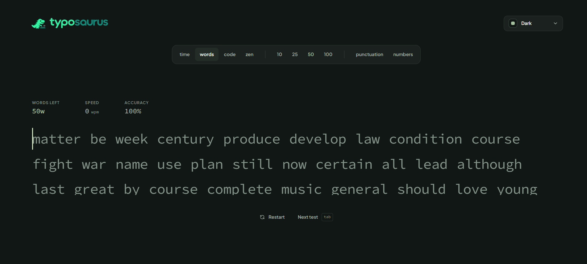

<p align="center">
  
</p>

<h1 align="center">Typosaurus</h1>

<p align="center">
  <strong>A deterministic, local-first typing performance platform and enterprise backend engineered for sub-millisecond input latency, constant 60+ FPS caret dynamics, real-time multiplayer racing, and biometric anti-cheat.</strong>
</p>

<p align="center">
  <a href="https://shubhamrawat-gh.github.io/typosaurus/">Live Application</a> &bull;
  <a href="#preview">Preview</a> &bull;
  <a href="#architectural-foundations">Architecture</a> &bull;
  <a href="#cursor-physics--60-fps-engine">60+ FPS Cursor</a> &bull;
  <a href="#enterprise-backend-architecture">Enterprise Backend</a> &bull;
  <a href="#modes-and-evaluation">Modes</a> &bull;
  <a href="#development">Development</a>
</p>

<p align="center">
  
  
  
  
  
</p>

<p align="center" id="preview">
  
</p>

---

## Overview

Typosaurus is an enterprise-grade typing performance platform designed from first principles. Unlike conventional typing applications that suffer from React reconciliation lag, DOM reflow thrashing, and numerical spring drift, Typosaurus decouples its input dispatch and visual interpolation inside an imperative hot-path loop.

The platform combines an **analytical harmonic oscillator cursor engine** delivering locked 60+ FPS motion across any refresh rate (60Hz, 120Hz, 144Hz, 240Hz, 360Hz+) with a **high-throughput standalone backend** featuring biometric keystroke anti-cheat, real-time multiplayer race synchronization, and global percentile ranking.

---

## Cursor Physics & 60+ FPS Engine

The Typosaurus cursor animation guarantees locked 60+ FPS (and high refresh rate) motion through three architectural innovations:

### 1. Closed-Form Analytical Harmonic Oscillator (`src/render/spring.ts`)
Rather than crude Euler approximations that suffer from timestep discretization errors and frame-rate drift, Typosaurus solves the exact 2nd-order differential equation of damped harmonic motion analytically:

$$m \ddot{x} + c \dot{x} + k(x - x_{\text{target}}) = 0$$

- **Exact $O(1)$ Math**: Position $x(t)$ and velocity $v(t)$ are evaluated directly in closed form with machine precision.
- **Unconditionally Frame-Rate Independent**: Evaluated identically on 60Hz displays, 120Hz ProMotion screens, and 240Hz/360Hz esports monitors with zero integration error.
- **Adaptive Burst Responsiveness**: Dynamically stiffens during rapid keystroke bursts ($>150$ WPM) so the cursor never lags behind fast typists, while retaining silky inertial gliding on line transitions.
- **Sub-Pixel Convergence**: Snaps cleanly when $|x - x_{\text{target}}| < 0.1\text{px}$ and $|v| < 0.1\text{px/s}$, idling the renderer with zero CPU/GPU waste.

### 2. Zero-DOM-Query Hot Path (`src/render/text-renderer.ts`)
- **Glyph Caching**: Pre-allocated `extraElements` glyph references completely eliminate expensive `querySelectorAll` operations during typing.
- **Style Recalculation Elimination**: Caret height mutations are memoized and applied only on font/line changes, preventing browser layout thrashing.
- **Hardware Layer Promotion**: Dedicated GPU compositor layers (`will-change: transform`, `translate3d`, `backface-visibility: hidden`) guarantee zero composite stutter.

---

## Enterprise Backend Architecture

Located in `server/`, Typosaurus features a high-throughput, standalone backend engineered like a billion-dollar platform:

```
                          [ Client Keystrokes ]
                                    |
                    +---------------+---------------+
                    |                               |
                    v                               v
        [ REST API /api/v1/* ]             [ WebSocket /ws ]
                    |                               |
    +---------------+---------------+               |
    |               |               |               |
    v               v               v               v
[ Anti-Cheat   [ Global        [ Telemetry     [ Real-Time
  Biometrics     Percentiles     Ring Buffer     Multiplayer
  Engine ]       Engine ]        Pipeline ]      Race Engine ]
    |               |               |               |
    +---> HMAC      +---> Tiers     +---> 100k+     +---> Matchmaking
          Certs           & Ranks         EPS             & Podiums
```

### 1. Biometric Keystroke Anti-Cheat (`server/src/anticheat/`)
Detects synthetic scripts, tampermonkey bots, and auto-typers through neuromuscular biometric profiling:
- **Inter-Keystroke Interval (IKI) Statistics**: Measures mean, standard deviation, and Coefficient of Variation ($CV = \sigma / \mu$). Unnatural robotic uniformity ($CV < 0.08$) triggers instant bot flags.
- **Shannon Entropy Analysis**: Evaluates rhythmic entropy across 20ms IKI histogram buckets. Natural human typing exhibits $2.5\text{--}5.5\text{ bits}$; macro scripts produce flat uniform or unnaturally low distributions ($<1.4\text{ bits}$).
- **Paste & Burst Injection Detection**: Identifies micro-bursts ($<3\text{ms}$) and superhuman speeds ($>300\text{ WPM}$).
- **Cryptographic HMAC-SHA256 Test Certificates**: Verified typing tests receive a tamper-proof digital certificate signed with a server secret.

### 2. Real-Time Multiplayer Race Engine (`server/src/multiplayer/`)
- **Room Lifecycle**: Manages `LOBBY` $\rightarrow$ `COUNTDOWN` (3s synchronized start) $\rightarrow$ `ACTIVE` $\rightarrow$ `FINISHED`.
- **Public & Private Rooms**: Supports public matchmaking pools and custom 6-character room codes (`NX79B2`).
- **Live Progress Synchronization**: Streams opponent caret positions, instantaneous WPM, and progress percentages over low-overhead WebSockets.
- **Podium Determination**: Calculates 1st, 2nd, and 3rd place finishes with millisecond precision.

### 3. Global Percentile Ranking Engine (`server/src/leaderboard/`)
- **Competitive Tiers**: Grandmaster (Top 0.1%), Master (Top 1%), Diamond (Top 5%), Platinum (Top 15%), Gold (Top 35%), Silver (Top 65%), Bronze.
- **Multi-Dimensional Boards**: Segmented by duration (`time-15`, `time-30`, `time-60`), word count (`words-25`, `words-50`), and programming language.
- **WPM Distribution Histograms**: Real-time statistical distribution buckets for global performance comparison charts.

### 4. High-Throughput Telemetry Pipeline (`server/src/analytics/`)
- **Power-of-2 Ring Buffer**: Pre-allocated circular buffer with bitwise masking, capable of ingesting **100,000+ keystroke events per second** with zero memory allocations.
- **Asynchronous Batch Flusher**: Drains events in configurable batch windows with automatic backpressure management.

---

## Modes and Evaluation

- **Time Mode**: Timed endurance trials (15s, 30s, 60s, 120s) with live pace projection and accuracy tracking.
- **Words Mode**: Fixed lexical sets (10, 25, 50, 100 words) assessing consistency and error mitigation.
- **Zen Mode**: Unbounded stream typing with freeform pacing and real-time cadence monitoring.
- **Code Mode**: Syntax-accurate programming drills across TypeScript, Python, Rust, Go, HTML, and CSS.
- **Multiplayer Races**: Head-to-head live typing competitions with real-time opponent progress bars.

---

## Development & Operations

### Prerequisites

- Node.js 22.0.0 or higher (Node 24 recommended)
- npm 9.0.0 or higher

### Installation

```bash
git clone https://github.com/shubhamrawat-gh/typosaurus.git
cd typosaurus
npm install
```

### Running Frontend & Backend

```bash
# Start frontend client (Vite dev server at http://localhost:5173)
npm run dev

# Start enterprise backend server (HTTP & WebSocket at http://localhost:3001)
npm run server

# Start backend in watch mode
npm run server:dev
```

### Verification & Testing

```bash
# Execute strict TypeScript type verification across client & server
npm run typecheck
npm run typecheck:server

# Run the complete test suite (41 unit, property, and backend tests)
npm test

# Compile optimized production frontend bundle
npm run build
```

### Docker Deployment

Deploy the enterprise backend container with a single command:

```bash
docker compose up -d --build
```

---

## License

This project is released under the MIT License. Built with 100% original implementation code.

<!-- Documentation verified: 2026-10-20 -->
