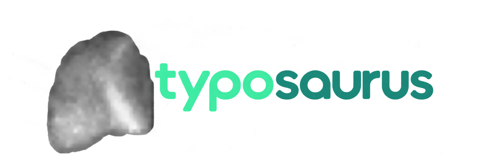

<p align="center">
  
  <br />
  
</p>

<h1 align="center">Typosaurus</h1>

<p align="center">
  <strong>A deterministic, local-first typing performance platform engineered for sub-millisecond input latency and locked 60 FPS animation loops.</strong>
</p>

<p align="center">
  <a href="https://shubhamrawat-gh.github.io/typosaurus/">Live Application</a> &bull;
  <a href="#preview">Preview</a> &bull;
  <a href="#branding--assets">Assets</a> &bull;
  <a href="#architectural-foundations">Architecture</a> &bull;
  <a href="#engine-specifications">Engine Specs</a> &bull;
  <a href="#modes-and-evaluation">Modes</a> &bull;
  <a href="#audio-synthesis">Audio Engine</a> &bull;
  <a href="#development">Development</a>
</p>

<p align="center">
  
  
  
  
  
  
</p>

<p align="center" id="preview">
  
</p>

---

## Overview

Typosaurus is a minimalist, precision-tuned typing software architecture designed from first principles. Unlike conventional typing web applications that trigger React reconciliation cascades on every keystroke, Typosaurus isolates its input dispatch and visual interpolation inside an imperative hot-path loop. Keystroke registration, spring caret dynamics, and procedural audio synthesis execute deterministically within a 16.67ms frame budget.

All metrics, user preferences, and historical test aggregates reside strictly within client-side IndexedDB. Zero telemetry, zero analytics tracking, and zero runtime network dependencies.

---

## Architectural Foundations

### 1. Decoupled Imperative Hot Path
React governs application shell mounting, theme switches, and high-level route orchestration. The active typing session operates completely outside React state:
- Keystroke events fire directly into an imperative reducer.
- Active caret coordinates and character render states are written straight to DOM/Canvas nodes via a persistent `requestAnimationFrame` loop.
- Garbage collection pressure is eliminated by pre-allocating state buffers and avoiding per-stroke object allocations.

```
[Hardware Key Event]
        |
        v
[Imperative Input Handler]
        |
        +---> [Procedural Web Audio Engine] (Instant acoustic feedback)
        |
        +---> [Typing State Reducer] (Buffer mutation, zero allocation)
                    |
                    +---> [Spring Caret Physics] (Interpolated rAF step)
                    |
                    +---> [Incremental DOM Patch] (Direct class list mutation)
                    |
                    +---> [Metrics Collector] (Timestamp buffer & error maps)
```

### 2. Spring-Physics Caret Mechanics
Rather than relying on stepped CSS keyframes, the cursor calculates its position through a damped harmonic oscillator model:
- Constant smooth transitions between variable character bounding boxes.
- Inertial recovery on rapid bursts and cadence changes.
- Responsive sizing and automatic line-wrapping recalibration.

### 3. Procedural Audio Synthesis
Typosaurus downloads zero audio files. Sound feedback is synthesized procedurally in real time via the browser's native `AudioContext`:
- Dynamic parametric envelopes (biquad filters, sine/triangle oscillators, transient click impulses).
- Three distinct acoustic profiles: Mechanical Switch, Soft Membrane, and Minimal Click.
- Zero audio-buffering latency and zero network overhead.

### 4. Local-First Persistence
Data sovereignty is guaranteed by design:
- Local IndexedDB storage powered by Dexie.js schema migrations.
- Detailed keystroke intervals, word accuracy maps, and weak-spot distributions remain entirely on the local machine.
- 100% functional without an active network connection.

---

## Engine Specifications

| Metric / Attribute | Specification |
|:---|:---|
| Target Frame Rate | Continuous 60 FPS (16.67ms budget) |
| Input Event Overhead | < 0.5ms dispatch-to-buffer latency |
| Network Dependency | 0 runtime HTTP requests |
| Audio Latency | Native Web Audio buffer-less synthesis |
| Storage Engine | IndexedDB (Dexie client layer) |
| Bundle Size | Optimized production distribution |
| Type System | TypeScript Strict Mode (`noImplicitAny`, strict null checks) |

---

## Modes and Evaluation

Typosaurus includes comprehensive evaluation modes tailored for different training disciplines:

- **Time Mode**: Timed endurance trials (15s, 30s, 60s, 120s) with live pace projection and accuracy tracking.
- **Words Mode**: Fixed lexical sets (10, 25, 50, 100 words) assessing consistency and error mitigation.
- **Zen Mode**: Unbounded stream typing with freeform pacing, no countdown, and real-time cadence monitoring.
- **Code Mode**: Syntax-accurate programming language drills featuring structured indentation, brackets, and operators across:
  - TypeScript / JavaScript
  - Python
  - Rust
  - Go
  - HTML & CSS
- **Practice & Weakness Drills**: Targeted repetition targeting specific finger mechanics, homing keys, and error-prone digrams.

---

## Visual Design & Theming

The user interface adheres to a minimalist layout driven by design tokens and strict WCAG contrast standards. Themes dynamically remap CSS variables without causing layout thrashing:

- **Deep Forest**: Low-luminance greens paired with subtle earthy accents.
- **Obsidian**: High-contrast OLED dark palette for minimum eye strain.
- **Cyberpunk**: Vibrant neon cyan and magenta accents on deep ink canvas.
- **Chalkboard**: Matte monochromatic surface inspired by physical slate.
- **Solarized**: Scientifically balanced color temperature palette.

---

## Branding & Assets

All project branding, visual marks, and high-resolution media assets are organized within the [`assets/`](./assets) section for repository documentation, presentation, and external use:

| Asset | Preview | Specifications | Repository Path |
| :--- | :---: | :--- | :--- |
| **Primary Logo** |  | High-Resolution Mascot Emblem (PNG) | [`assets/logo.png`](./assets/logo.png) |
| **Wordmark** |  | Brand Typographic Wordmark (PNG) | [`assets/text-logo.png`](./assets/text-logo.png) |
| **Favicon Master** |  | Master Application Icon (PNG) | [`assets/favicon.png`](./assets/favicon.png) |
| **Favicon 32x32** |  | Standard Web Browser Tab Icon (PNG) | [`assets/favicon-32x32.png`](./assets/favicon-32x32.png) |
| **Apple Touch Icon** |  | iOS / Mobile Home Screen Icon (PNG) | [`assets/apple-touch-icon.png`](./assets/apple-touch-icon.png) |
| **Live Arena Screenshot** |  | High-Fidelity Application Capture (PNG) | [`assets/live-ss.png`](./assets/live-ss.png) |

> **Note on Static Bundling**: Runtime web assets required for Vite bundler packaging and GitHub Pages hosting are served from [`public/`](./public) for direct static asset resolution.

---

## Repository Structure

```
.
├── .github/
│   └── workflows/
│       └── deploy.yml          # Automated GitHub Pages CI/CD pipeline
├── assets/                     # Official brand marks, icons, and repository media
│   ├── apple-touch-icon.png    # Mobile home screen icon
│   ├── favicon-32x32.png       # 32x32 browser tab icon
│   ├── favicon.png             # Master brand icon
│   ├── live-ss.png             # Application arena preview screenshot
│   ├── logo.png                # Primary high-resolution emblem
│   └── text-logo.png           # Typographic wordmark
├── public/                     # Static production assets served by Vite
│   ├── apple-touch-icon.png
│   ├── favicon-32x32.png
│   ├── favicon.png
│   ├── logo.png
│   └── text-logo.png
├── src/
│   ├── audio/                  # Procedural Web Audio API sound synthesizers
│   ├── components/             # React shell components and overlays
│   ├── data/                   # Wordlists, practice drills, and code snippets
│   ├── engine/                 # Core imperative typing engine, reducers, and types
│   ├── fx/                     # Spring caret physics and visual interpolation
│   ├── render/                 # Hot-path DOM and text renderers
│   ├── storage/                # Dexie IndexedDB client and database schemas
│   ├── styles/                 # Design tokens and Tailwind foundations
│   ├── ui/                     # Navigation headers, arena, and theme selectors
│   ├── App.tsx                 # Root application container
│   └── main.tsx                # Client bootstrap entrypoint
├── tests/                      # Vitest unit, reducer, and property tests
├── index.html                  # HTML5 application template
├── tsconfig.json               # TypeScript compiler configuration
├── vite.config.ts              # Vite bundler and path configuration
└── README.md                   # Technical documentation
```

---

## Development

### Prerequisites

- Node.js 18.0.0 or higher
- npm 9.0.0 or higher

### Installation

Clone the repository and install dependencies:

```bash
git clone https://github.com/shubhamrawat-gh/typosaurus.git
cd typosaurus
npm install
```

### Development Server

Start the local Vite development server with Hot Module Replacement:

```bash
npm run dev
```

The application will be accessible at `http://localhost:5173`.

### Quality and Verification

Run type checking, unit tests, and production validation suites:

```bash
# Execute strict TypeScript type verification
npm run typecheck

# Execute unit and property test suites via Vitest
npm run test

# Compile production bundle
npm run build

# Preview production build locally
npm run preview
```

---

## Deployment to GitHub Pages

Typosaurus includes an automated GitHub Actions deployment workflow at `.github/workflows/deploy.yml`.

### Automated Deployment via GitHub Actions

1. Push changes to the `main` branch.
2. In your repository settings on GitHub, navigate to **Settings** > **Pages**.
3. Under **Build and deployment** > **Source**, select **GitHub Actions**.
4. The deployment pipeline will automatically build the application and deploy it to:

```
https://shubhamrawat-gh.github.io/typosaurus/
```

*Note: For private repositories, GitHub Pages requires a GitHub Pro, Team, or Enterprise plan. If operating on a standard free tier, configure the repository visibility to Public in repository settings to enable GitHub Pages hosting.*

---

## License

This project is released under the MIT License. Built with 100% original implementation code without third-party typing test codebase dependencies.
